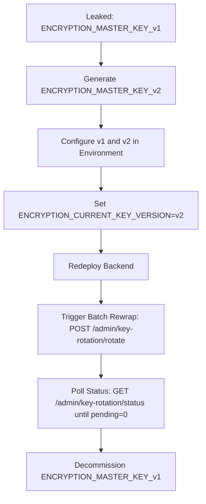

# Incident Response Runbook: Leaked Application Secrets

**Issue:** #2227  
**Scope:** Secret Containment, Key Rotation, Session Invalidation, Log Review, and Redeployment  
**Audience:** Core Maintainers, Security Responders, and DevOps Engineers  

---

## 1. Overview & Immediate Actions (First 15 Minutes)

When an application secret (API keys, encryption keys, Stellar seed phrases, database credentials, or JWT signing secrets) is exposed—via git history, logs, public issue trackers, error messages, or third-party disclosure—execute this runbook immediately.

### Guiding Principles

1. **Rotate First, Ask Questions Later**: Assume any leaked secret was harvested immediately by automated bots. Never wait to confirm exploitation before rotating.
2. **Zero Real Secrets in Incidents**: Never paste real secret values in GitHub issues, PRs, Slack/Discord channels, or incident tickets. Use placeholders such as `<NEW_JWT_SECRET>` or `<COMPROMISED_KEY_VERSION>`.
3. **Invalidate Sessions & Access**: Rotating secrets must actively invalidate active sessions or old keys, not merely change configurations for new users.
4. **Preserve Forensic Evidence**: Before clearing or rotating databases and logs, ensure container logs and audit logs from the breach window are backed up securely for forensic analysis.

### Immediate Containment Checklist

- [ ] **Determine the Exposure Window**: Identify the earliest timestamp when the secret was committed, logged, or exposed.
- [ ] **Assess Blast Radius**: Identify which systems and data are accessible using the leaked secret (see Section 2).
- [ ] **Optional Emergency Pause**: If active tampering, unauthorized admin actions, or data exfiltration is detected, place the platform in read-only mode immediately:
  ```bash
  export XCONFESS_PAUSE_WRITES=true
  # See docs/incident-runbook.md for full emergency pause procedures
  ```
- [ ] **Notify On-Call Maintainers**: Alert the core security team with the specific secret type and exposure source (without sharing the secret itself).

---

## 2. Affected Environment Variables & Secret Inventory

The table below lists every secret in XConfess, its blast radius, generation command, and required rotation mechanism:

| Environment Variable | Classification | Blast Radius If Leaked | Generation Command | Rotation Strategy |
| --- | --- | --- | --- | --- |
| `JWT_SECRET` | Authentication | Attacker can forge valid JWT tokens, impersonate any user or admin, and bypass authentication. | `openssl rand -base64 48` | **Instant**: Update env & restart. All existing sessions are immediately invalidated. |
| `APP_SECRET` | Application Salt / Signing | Attacker can forge data export signed URLs or correlate anonymous wallet fingerprints. | `openssl rand -base64 48` | **Instant**: Update env & restart. Expired export URLs reject immediately. |
| `ENCRYPTION_MASTER_KEY_v*` | Envelope Encryption (Master KEK) | Attacker with read access to DB can unwrap DEKs and decrypt confession content. | `openssl rand -hex 32` | **Zero-Downtime Envelope Rotation**: Deploy v(N+1), trigger batch rewrap via `/admin/key-rotation/rotate`, decommission old key. |
| `CONFESSION_ENCRYPTION_KEY` | Legacy Confession Cipher | Attacker with DB read access can decrypt legacy static-key confessions. | `openssl rand -hex 32` | Update env, migrate legacy records to envelope encryption, decommission. |
| `STELLAR_SERVER_SECRET` | Blockchain Signer | Attacker can sign arbitrary Stellar transactions from the server wallet and drain funds. | `stellar keys generate --network testnet new-key` | **Immediate Fund Sweep**: Generate new keypair, transfer remaining XLM/tokens, update env, restart. |
| `DB_PASSWORD` | Infrastructure | Direct read/write access to PostgreSQL database if port 5432 is exposed. | `openssl rand -base64 32` | `ALTER USER` in Postgres, update env, rolling restart. |
| `REDIS_PASSWORD` | Queue / Cache | Read/write access to BullMQ queues (notifications, exports) and cached sessions. | `openssl rand -base64 32` | `CONFIG SET requirepass` in Redis, update env, restart workers. |
| `MAIL_PASSWORD` / `MAIL_FALLBACK_PASSWORD` | Third-Party Service | Attacker can send phishing emails from `@xconfess.com` via SMTP. | Provider Console | Revoke API key / password at SMTP provider, update env, restart. |

---

## 3. Step-by-Step Rotation Procedures

### Scenario A: Leaked `JWT_SECRET` (Session Invalidation)

Rotating `JWT_SECRET` immediately causes all existing JWT access tokens to fail cryptographic verification (`JsonWebTokenError: invalid signature`), kicking out all active users including the attacker.

1. **Generate Replacement Secret**:
   ```bash
   NEW_JWT_SECRET=$(openssl rand -base64 48)
   ```
2. **Update Environment**:
   Update `JWT_SECRET` in your container orchestration environment (AWS ECS, Kubernetes Secrets, Doppler, or `.env` in production):
   ```bash
   JWT_SECRET="$NEW_JWT_SECRET"
   ```
3. **Restart Backend**:
   ```bash
   # Docker Compose:
   docker compose up -d --no-deps backend
   # Or Kubernetes:
   kubectl rollout restart deployment/xconfess-backend
   ```
4. **Invalidate Redis Caches & WebSockets**:
   If WebSocket connections or cached token metadata exist:
   ```bash
   redis-cli -h $REDIS_HOST -p $REDIS_PORT FLUSHDB
   ```
5. **Verify Session Invalidation**:
   ```bash
   # An old token must now be rejected with 401 Unauthorized
   curl -i http://localhost:5000/api/users/me \
     -H "Authorization: Bearer <OLD_JWT_TOKEN>"
   # Expected: HTTP 401 Unauthorized ("Invalid token" or "jwt signature is invalid")
   ```

---

### Scenario B: Leaked `ENCRYPTION_MASTER_KEY_v*` (Zero-Downtime Envelope Rotation)

XConfess uses envelope encryption (AES-256-GCM) where each confession content is encrypted with a unique Data Encryption Key (DEK). Only the DEK is wrapped with the Master Key. Key rotation re-wraps the DEKs without touching ciphertext.



1. **Generate Next Master Key Version**:
   ```bash
   # Must be exactly 64 hexadecimal characters (32 bytes)
   NEW_MASTER_KEY=$(openssl rand -hex 32)
   ```
2. **Update Environment to Support Both Versions**:
   Keep the compromised key (`v1`) in the configuration so existing rows can be decrypted, while setting the active version to `v2`:
   ```bash
   ENCRYPTION_MASTER_KEY_v1="<COMPROMISED_KEY_KEEP_FOR_REWRAP>"
   ENCRYPTION_MASTER_KEY_v2="$NEW_MASTER_KEY"
   ENCRYPTION_CURRENT_KEY_VERSION="v2"
   ```
3. **Restart / Redeploy Backend**:
   New confessions submitted from this point onward will automatically be encrypted under `v2`.
4. **Obtain Step-Up Authorization Proof**:
   Destructive admin operations require a short-lived step-up token issued via `POST /auth/step-up`:
   ```bash
   STEP_UP_TOKEN=$(curl -s -X POST http://localhost:5000/api/auth/step-up \
     -H "Authorization: Bearer <ADMIN_JWT>" \
     -H "Content-Type: application/json" \
     -d '{"password": "<ADMIN_PASSWORD>"}' | jq -r '.stepUpToken')
   ```
5. **Execute Dry-Run Rotation**:
   Verify key compatibility without writing to database:
   ```bash
   curl -s -X POST "http://localhost:5000/api/admin/key-rotation/rotate?dryRun=true&batchSize=500" \
     -H "Authorization: Bearer <ADMIN_JWT>" \
     -H "x-step-up-token: $STEP_UP_TOKEN" | jq .
   ```
6. **Execute Live Master Key Rotation**:
   ```bash
   curl -s -X POST "http://localhost:5000/api/admin/key-rotation/rotate?batchSize=500" \
     -H "Authorization: Bearer <ADMIN_JWT>" \
     -H "x-step-up-token: $STEP_UP_TOKEN" | jq .
   ```
   *Note: If processing a large dataset, use the `resumeAfterId` query parameter returned by previous batches.*
7. **Verify Completion**:
   ```bash
   curl -s http://localhost:5000/api/admin/key-rotation/status \
     -H "Authorization: Bearer <ADMIN_JWT>" | jq .
   # Expected: { "pendingCount": 0, "checkedAt": "..." }
   ```
8. **Decommission Compromised Key**:
   Remove `ENCRYPTION_MASTER_KEY_v1` from the environment and restart the backend. Any attempt to use `v1` will now safely fail.

---

### Scenario C: Leaked `STELLAR_SERVER_SECRET` (On-Chain Server Key)

A leaked Stellar secret seed (`S...`) allows immediate transaction signing. Time is critical.

1. **Generate New Stellar Keypair**:
   ```bash
   stellar keys generate --network testnet new-server-wallet
   NEW_PUBLIC_KEY=$(stellar keys address new-server-wallet)
   NEW_SECRET_KEY=$(stellar keys show new-server-wallet)
   ```
2. **Immediately Sweep Remaining Funds**:
   Using the Stellar CLI or Laboratory, transfer all remaining native XLM and trustline tokens from the compromised address to `$NEW_PUBLIC_KEY`:
   ```bash
   stellar xlm transfer \
     --network testnet \
     --source-account <COMPROMISED_SEED> \
     --destination $NEW_PUBLIC_KEY \
     --amount <ALL_AVAILABLE_BALANCE>
   ```
3. **Update Contract Admin / Signers (If Applicable)**:
   If the leaked server account held admin or signer permissions on Soroban contracts, invoke the admin transfer function:
   ```bash
   stellar contract invoke \
     --id $CONFESSION_ANCHOR_CONTRACT_ID \
     --source-account <COMPROMISED_SEED> \
     --network testnet \
     -- set_admin --new_admin $NEW_PUBLIC_KEY
   ```
4. **Update Environment & Restart**:
   ```bash
   STELLAR_SERVER_SECRET="$NEW_SECRET_KEY"
   ```
5. **Verify Anchor Transactions**:
   Submit a test anchor transaction or tip verification to confirm the new keypair is functioning.

---

### Scenario D: Leaked `APP_SECRET`

`APP_SECRET` is used to compute irreversible `walletFingerprint` hashes and sign data export download tokens.

1. **Generate New Secret**:
   ```bash
   NEW_APP_SECRET=$(openssl rand -base64 48)
   ```
2. **Update Environment & Restart**:
   ```bash
   APP_SECRET="$NEW_APP_SECRET"
   ```
3. **Effect on Active Features**:
   - Any unexpired signed export download tokens (`/data-export/download?token=...`) will immediately fail validation. Users must request a new export.
   - Future wallet interactions will hash against the new secret.

---

### Scenario E: Leaked Database or Redis Credentials

1. **PostgreSQL (`DB_PASSWORD`)**:
   ```sql
   -- Connect via psql as superuser:
   ALTER USER xconfess WITH PASSWORD '<NEW_PASSWORD>';
   ```
   Update `DB_PASSWORD` in environment configuration and restart the application backend.
2. **Redis (`REDIS_PASSWORD`)**:
   ```bash
   redis-cli -h $REDIS_HOST -p $REDIS_PORT -a "<OLD_PASSWORD>" CONFIG SET requirepass "<NEW_PASSWORD>"
   redis-cli -h $REDIS_HOST -p $REDIS_PORT -a "<NEW_PASSWORD>" CONFIG REWRITE
   ```
   Update `REDIS_PASSWORD` in backend environment and restart.

---

## 4. Log Review & Forensic Audit

Once containment is complete, determine whether the leaked secret was abused during the exposure window.

### 4.1 Audit Log Investigation

Query the PostgreSQL database for security events during the compromise window:

```sql
-- 1. Review all admin actions during the breach window
SELECT id, action, "adminId", "ipAddress", "createdAt", metadata
FROM audit_logs
WHERE "createdAt" >= NOW() - INTERVAL '48 hours'
ORDER BY "createdAt" DESC;

-- 2. Check for unexpected key rotation or contract invocation events
SELECT id, action, metadata, "createdAt"
FROM audit_logs
WHERE action IN ('KEY_ROTATION', 'STELLAR_CONTRACT_INVOCATION')
  AND "createdAt" >= NOW() - INTERVAL '48 hours';

-- 3. Review data export requests created during exposure
SELECT id, "userId", status, "createdAt"
FROM data_export_jobs
WHERE "createdAt" >= NOW() - INTERVAL '48 hours';
```

### 4.2 Application Log Inspection

Search backend structured logs for requests originating from unexpected IPs or endpoints:

```bash
# Search for access using admin routes during the incident window
docker logs xconfess-backend --since "48h" 2>&1 \
  | grep -E '"route":"/admin/' \
  | grep -v 'health'

# Search for 401 unauthorized spikes (indicator of invalid token probing)
docker logs xconfess-backend --since "48h" 2>&1 \
  | grep '"status":401' \
  | head -50

# Confirm log redaction caught any accidental outputs
docker logs xconfess-backend --since "48h" 2>&1 \
  | grep -E "S[A-Z2-7]{55}"
# Expected: Empty (Stellar seeds must be scrubbed by log redaction)
```

### 4.3 Blockchain Activity Audit

For `STELLAR_SERVER_SECRET`, inspect the public ledger via Horizon API:

```bash
curl -s "https://horizon-testnet.stellar.org/accounts/<COMPROMISED_PUBLIC_KEY>/transactions?limit=50&order=desc" \
  | jq '.embedded.records[] | { id, created_at, memo, successful }'
```
Review every transaction created during the exposure window to ensure no unauthorized contract calls or asset transfers occurred.

---

## 5. Redeployment & Health Validation

After environment secrets have been updated across your hosting provider:

1. **Perform Rolling Service Restart**:
   ```bash
   kubectl rollout restart deployment/xconfess-backend
   kubectl rollout status deployment/xconfess-backend
   ```
2. **Verify Health Probes**:
   ```bash
   curl -s http://localhost:5000/api/health/ready | jq .
   curl -s http://localhost:5000/api/health/live | jq .
   # Expected status: "ok"
   ```
3. **Verify Read and Write Workflows**:
   - Submit a test confession (`POST /confessions`) to ensure encryption with active keys succeeds.
   - Fetch public feed (`GET /confessions`) to verify decryption succeeds.
   - Test user login (`POST /auth/login`) to ensure JWT generation and verification work with the new `JWT_SECRET`.

---

## 6. Git History Sanitization & Post-Mortem

If the secret was exposed via a public or shared Git repository:

1. **Assume Exposure Regardless of History Rewrite**:
   Rewriting git history removes the secret from the repository going forward, but does NOT protect against bots that cloned the repository while it was public. Complete Sections 2 and 3 first.
2. **Remove Secret from Git History (Using BFG Repo-Cleaner or git-filter-repo)**:
   ```bash
   # Using git-filter-repo to scrub a file containing secrets
   git filter-repo --invert-paths --path .env.production
   # Or replace text in history
   git filter-repo --replace-text <(echo "leaked_secret_string==>REDACTED")
   ```
3. **Force Push Cleaned Branches**:
   ```bash
   git push origin --force --all
   git push origin --force --tags
   ```
4. **Invalidate Personal Access Tokens / Deploy Keys**:
   If the repository itself was compromised, revoke and regenerate all GitHub deploy keys and personal access tokens.
5. **Post-Mortem & Prevention**:
   - File an incident post-mortem documenting timeline, root cause, and impact.
   - Verify pre-commit secret scanners (e.g., `git-secrets`, `trufflehog`) are configured on all contributor machines.

---

## 7. Automated Regression Verification

Contributors and security engineers can verify all secret rotation and session invalidation invariants using the test suite:

```bash
# Run the leaked secrets rotation regression suite
npm run test --workspace=xconfess-backend -- src/common/security/leaked-secrets-rotation.spec.ts

# Run environment validation tests
npm run test --workspace=xconfess-backend -- src/config/env.validation.spec.ts

# Run encryption service envelope rotation tests
npm run test --workspace=xconfess-backend -- src/encryption/encryption.service.spec.ts
```

---

## 8. Related Documentation

- [Incident Runbook: Emergency Pause, DLQ, and Auth](incident-runbook.md) — Operational procedures for emergency pauses and DLQs.
- [Contract Signer Key Rotation Runbook](contract-signer-rotation-runbook.md) — On-chain smart contract signer rotation and timelocks.
- [Privacy Data-Flow Map](privacy-data-flow-map.md) — Map of sensitive fields across database, logs, and queue boundaries.
- [Attaching Logs Guide](LOG_ATTACHING_GUIDE.md) — Redaction rules when attaching diagnostic logs to issues.
