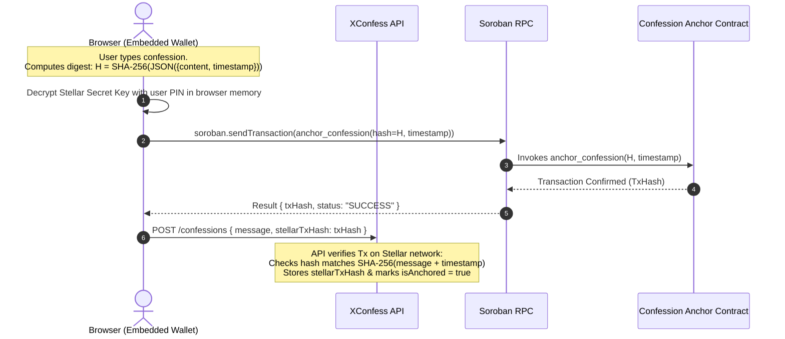
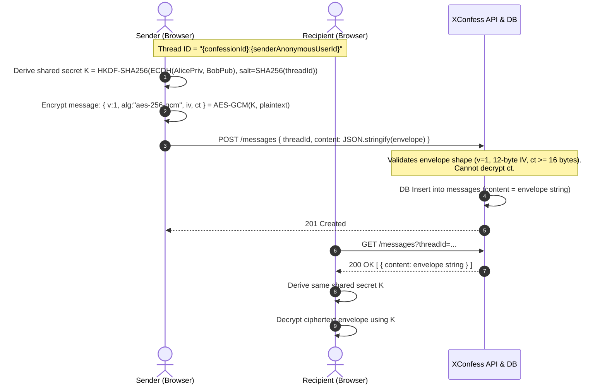

# Privacy Data-Flow Map for Anonymous Interactions

**Issue:** #2226  
**Status:** Active  
**Scope:** Browser, API, Database, Queues, Logs, and Stellar Boundaries  

---

## 1. Executive Summary & Guiding Principles

XConfess enables users to share confessions, interact, and send direct messages while preserving sender anonymity and preventing identity correlation. This document maps the journey of identity, confession content, and metadata across every system boundary.

### Guiding Principles

1. **Zero Server Knowledge for Private Messages**: Private messages are encrypted end-to-end (E2E) in the browser with AES-256-GCM. The API server stores and relays ciphertext envelopes only; it never possesses user private keys or plaintext message content.
2. **Confession Encryption at Rest**: Confession content is encrypted server-side using AES-256-CBC (`ivHex:cipherHex`) before persistence. An explicit runtime guard (`assertEncryptedBeforeSave`) aborts persistence if unencrypted plaintext reaches the persistence layer.
3. **Identity Decoupling**: Authenticated user accounts (`users`) are strictly separated from anonymous personas (`anonymous_users`). The link table (`user_anonymous_users`) is private account state and scoped to a 24-hour rotating session window. Unauthenticated interactions use standalone, unlinked anonymous identities.
4. **Zero Plaintext on Public Ledger**: The Stellar Soroban contract receives only a cryptographic digest (`SHA-256(JSON.stringify({ content, timestamp }))`) and unix timestamp. No confession text, user identity, or IP address is ever committed to the blockchain.
5. **Defense-in-Depth Log Redaction**: Structured loggers, exception filters, and audit log pipelines scrub secrets, private keys, Stellar secret seeds (`S[A-Z2-7]{55}`), JWT tokens, and ciphertext payloads before log records touch stdout or disk.

---

## 2. System Architecture & Privacy Boundaries

The diagram below illustrates the six core boundaries and how data travels across them:

```mermaid
flowchart TD
    subgraph Browser ["1. Browser Boundary"]
        UI[React UI]
        IDB[(IndexedDB: E2E Keys)]
        LS[(localStorage: PIN-Encrypted Wallet)]
    end

    subgraph API ["2. API Boundary (NestJS)"]
        Sanitize[Sanitization & Request ID]
        AnonCtx[Anonymous Context Middleware]
        Moderation[AI Moderation in Memory]
        ConfEncrypt[Confession Encryption Service]
        Logger[Structured Logger & Log Redaction]
    end

    subgraph Storage ["3. Database Boundary (PostgreSQL)"]
        DB_AnonConf[(anonymous_confessions)]
        DB_Users[(users - encrypted PII)]
        DB_UserAnon[(user_anonymous_users)]
        DB_Messages[(messages - E2E ciphertext)]
        DB_Audit[(audit_logs - redacted)]
    end

    subgraph Async ["4. Queue Boundary (Redis / BullMQ)"]
        Q_Notif[notifications queue]
        Q_Export[export-queue]
        Q_DLQ[notifications-dlq]
    end

    subgraph Ledger ["5. Stellar / Soroban Boundary"]
        RPC[Soroban RPC]
        Contract[Confession Anchor Contract]
    end

    subgraph Observability ["6. Logs & Telemetry"]
        Logs[stdout / Redacted Logs]
    end

    UI -->|Plaintext + PIN| LS
    UI -->|X25519 Private Key| IDB
    UI -->|POST /confessions: Plaintext message| Sanitize
    UI -->|POST /messages: E2E Ciphertext Envelope| Sanitize
    UI -->|Soroban RPC: Sign & Anchor Hash| RPC

    Sanitize --> AnonCtx
    AnonCtx --> Moderation
    Moderation --> ConfEncrypt
    ConfEncrypt -->|AES-256-CBC Ciphertext| DB_AnonConf

    API -->|E2E Ciphertext Only| DB_Messages
    API -->|HMAC-SHA256 Wallet Fingerprint| DB_UserAnon
    API -->|Masked Event Metadata| DB_Audit

    API -->|Job: [Encrypted message] preview| Q_Notif
    API -->|Job: Export token| Q_Export

    RPC -->|anchor_confession: 32-byte hash| Contract

    API -.->|Redacted Payloads| Logger
    Logger -.-> Logs
```

---

## 3. Boundary-by-Boundary Data Flow

### 3.1 Browser Boundary

The client environment is responsible for key generation, user interaction, and client-side encryption.

| Data Item | Storage Location | Protection Mechanism | Boundary Crossing |
| --- | --- | --- | --- |
| **Stellar Private Key** | `localStorage` (`xconfess_wallet`) | PBKDF2-SHA256 (100k iterations) + AES-GCM (256-bit). Key derived from user-entered PIN. | **Never leaves browser**. Decrypted in memory only to sign Soroban transactions. |
| **Stellar Public Key** | `localStorage` / React State | Public by design (`G...` address). | Sent in `x-stellar-wallet` header or body for wallet verification. |
| **E2E Private Key** | IndexedDB (`xconfess-crypto-keys`) | Non-extractable Web Crypto CryptoKey or client-isolated storage. | **Never leaves browser**. |
| **E2E Public Key** | IndexedDB / React State | Public X25519 key (base64url). | Sent to backend during handshake/key exchange. |
| **Confession Draft** | React State (in-memory) | Transient memory; cleared on submit or page leave. | Sent to `POST /confessions` over TLS. |
| **Direct Message Text**| React State (in-memory) | Encrypted with AES-256-GCM before HTTP POST. | Only ciphertext envelope `{ v, alg, iv, ct }` crosses the network. |

---

### 3.2 API Boundary (NestJS)

The API boundary enforces sanitization, identity mapping, moderation, and encryption before storage.

```mermaid
sequenceDiagram
    autonumber
    actor User as Browser Client
    participant MW as Middleware Pipeline
    participant Mod as AI Moderation Service
    participant Enc as Encryption Service
    participant DB as PostgreSQL

    User->>MW: POST /confessions (message, tags, stellarTxHash)
    Note over MW: RequestIdMiddleware generates requestId<br/>SanitizationMiddleware strips HTML tags<br/>AnonymousContextMiddleware sets context
    MW->>Mod: moderateContent(cleanMessage)
    Note over Mod: Evaluated in memory;<br/>not logged
    Mod-->>MW: Moderation status (APPROVED / PENDING)
    MW->>Enc: encryptConfession(cleanMessage, aesKey)
    Note over Enc: AES-256-CBC with random 16-byte IV<br/>Produces "ivHex:cipherHex"
    Enc->>Enc: assertEncryptedBeforeSave(ciphertext)
    Enc->>DB: INSERT INTO anonymous_confessions (message=ciphertext, ...)
    DB-->>User: 201 Created (id, moderationStatus, public metadata)
```

#### Middleware & Interceptors
1. **`RequestIdMiddleware`**: Attaches a unique UUID to `req.id` and response headers for distributed tracing without exposing PII.
2. **`SanitizationMiddleware`**: Strips malicious markup using an allowlist (`b, i, em, strong, p, br, ul, ol, li, blockquote, code, pre`).
3. **`AnonymousContextMiddleware`**: 
   - Checks if caller is authenticated.
   - If authenticated, calls `AnonymousUserService.getOrCreateForUserSession(userId, 24)` to resolve or create a linked anonymous identity.
   - Exposes `req.anonymousContextId` and writes `x-anonymous-context-id` response header.
4. **`StructuredLoggingInterceptor`**: Intercepts requests/responses and logs route templates (e.g., `/confessions/:id`), status code, duration, and masked user ID (`user_${hash}`). It never logs raw confession plaintext or request authorization headers.

---

### 3.3 Database Boundary (PostgreSQL)

Sensitive fields across core entities and their storage invariants:

| Table | Sensitive Field | Raw Form | Storage State | Rationale / Invariant |
| --- | --- | --- | --- | --- |
| `anonymous_confessions` | `message` | Plaintext confession | AES-256-CBC ciphertext (`ivHex:cipherHex`) | Confession content is confidential; plaintext is never stored in DB. |
| `anonymous_confessions` | `encrypted_content` | Plaintext confession | Envelope-encrypted DEK format | Key rotation envelope for KMS migration. |
| `anonymous_confessions` | `stellar_tx_hash` | Hex string | Public transaction hash (unique) | Proves on-chain anchoring without exposing message. |
| `anonymous_confessions` | `stellar_hash` | SHA-256 digest | 64-char hex string | Digest of `{ content, timestamp }` matching on-chain anchor. |
| `user_anonymous_users` | `user_id` | Integer | Foreign key to `users` | Maps real account to anonymous persona within 24h window. Strictly private to account. |
| `user_anonymous_users` | `anonymous_user_id` | UUID | Foreign key to `anonymous_users` | Decoupled identity handle. |
| `anonymous_users` | `wallet_fingerprint` | Stellar public key (`G...`) | HMAC-SHA256 (`hex`) | Prevents wallet address enumeration while allowing Sybil resistance. |
| `messages` | `content` | Plaintext message | AES-256-GCM envelope (`{v, alg, iv, ct}`) | Zero-knowledge server storage. Plaintext impossible to recover server-side. |
| `messages` | `reply_content` | Quoted message | AES-256-GCM envelope | Same as content. |
| `users` | `email` | Plaintext email | AES-GCM encrypted (`email_encrypted`, `email_iv`, `email_tag`) | PII protection. Decrypted in memory only for required notifications. |
| `users` | `email_hash` | Email address | SHA-256 digest | Used for unique account constraint lookup without decrypting table. |
| `users` | `password` | Plaintext password | Bcrypt hash | Standard irreversible password hashing. |
| `users` | `totp_secret` | 32-char Base32 secret | Encrypted with IV | TOTP secret encrypted at rest. |
| `audit_logs` | `metadata` | JSON object | Pre-redacted JSON (`[REDACTED]`, `[REDACTED_EMAIL]`) | Audit entries scrub tokens, credentials, and ciphertexts before write. |

---

### 3.4 Queue & Asynchronous Workers Boundary (BullMQ / Redis)

Asynchronous queues process notification delivery and large data exports.

```mermaid
flowchart LR
    subgraph BullMQ ["Redis Queues"]
        N[notifications]
        E[export-queue]
        DLQ[notifications-dlq]
    end

    subgraph Producers ["API Producers"]
        ConfEvt[Confession Events]
        MsgEvt[Message Events]
        ExportEvt[Data Export Requests]
    end

    subgraph Consumers ["Queue Processors"]
        NotifProc[Notification Processor]
        ExportProc[Export Processor]
    end

    ConfEvt -->|Job: generic template, NO content| N
    MsgEvt -->|Job: message='[Encrypted message]'| N
    ExportEvt -->|Job: userId, exportId| E
    N -->|Failed after retries| DLQ

    N --> NotifProc
    E --> ExportProc
    NotifProc -->|Decrypts email in-memory only| Mail[SMTP / Push]
    ExportProc -->|HMAC-SHA256 signed download token| S3[Storage Bucket]
```

1. **`notifications` queue**:
   - `NotificationJobData`: `{ userId, type, title, message, idempotencyKey, requestId, metadata }`.
   - **For E2E Messages**: `message` is hardcoded to `[Encrypted message]` (`ENCRYPTED_PREVIEW`). Raw message plaintext or ciphertext envelope is never placed in the queue.
   - **Recipient Email**: Not included in job payload. The notification worker resolves and decrypts the email at delivery time.
2. **`export-queue`**:
   - Contains `{ userId, exportId, jobId }`.
   - Output files are generated asynchronously and accessed exclusively via HMAC-SHA256 signed URLs with 24-hour expiration.

---

### 3.5 Logs & Diagnostics Boundary

Logs are processed through layered redaction engines before hitting output streams.

#### Redaction Rules (`log-redaction.ts` & `audit-log-redaction.service.ts`)
1. **Exact Field Name Blacklist**:
   `password`, `passwordHash`, `secret`, `apiSecret`, `clientSecret`, `signingSecret`, `encryptionKey`, `privateKey`, `apiKey`, `stellarSecret`, `token`, `accessToken`, `refreshToken`, `jwtToken`, `authorization`, `cookie`, `encryptedPayload`, `ciphertext`, `seedPhrase`.
2. **Pattern-Based Field Name Matching**:
   `/secret/i`, `/password/i`, `/token$/i`, `/_token$/i`, `/privatekey/i`, `/encrypt/i`, `/cipher/i`, `/credential/i`, `/authorization/i`.
3. **Value-Based Pattern Matching (Independent of Field Name)**:
   - **JWT Tokens**: Matches `^[A-Za-z0-9_-]+\.[A-Za-z0-9_-]+\.[A-Za-z0-9_-]+$` → Replaced with `[REDACTED]`.
   - **Stellar Secret Seeds**: Matches `S[A-Z2-7]{55}` → Replaced with `[REDACTED_STELLAR_SEED]`.
   - **Long Hex Blobs (>= 40 chars)**: Masked to preserve debugging prefix: `0123...REDACTED`.
   - **Base64 Blobs (> 80 chars)**: Replaced with `[REDACTED]`.
   - **Email Addresses**: Masked as `jo***@example.com` or `[REDACTED_EMAIL]`.
4. **Preserved Operational Fields**:
   `requestId`, `correlationId`, `status`, `statusCode`, `method`, `route`, `path`, `duration`, `durationMs`, `subsystem`, `entityType`, `entityId`, `action`.

---

### 3.6 Stellar Blockchain / Soroban Boundary

The Stellar ledger acts as an immutable timestamped anchor for confession existence without compromising privacy.



#### What Crosses the Blockchain Boundary
- **Included on Chain**:
  - `hash`: 32-byte cryptographic digest (`BytesN<32>`).
  - `timestamp`: Unix timestamp (seconds).
  - Transaction signer public key (`G...`).
- **Never Sent to Chain**:
  - Confession text or words.
  - Category, tags, or demographic metadata (e.g., gender).
  - User identity, username, or IP address.
  - Session tokens or API IDs.

---

## 4. End-to-End Private Messaging Flow

Direct messaging between anonymous confession authors and readers uses X25519 ECDH and AES-256-GCM.



---

## 5. Sensitive Fields Inventory & Classification Matrix

| Category | Field / Identifier | Stored Location | Protection Mechanism | Access Restrictions |
| --- | --- | --- | --- | --- |
| **Credentials** | User Password | `users.password` | Bcrypt hash with salt | Write-only; verified during login. |
| **Credentials** | TOTP Secret | `users.totp_secret` | AES-256-GCM encrypted | Decrypted only during 2FA verification. |
| **Keys** | Stellar Secret Key | Browser `localStorage` | PBKDF2-SHA256 (100k) + AES-GCM | **Client only**. Never sent to server or DB. |
| **Keys** | E2E Messaging Private Key | Browser `IndexedDB` | WebCrypto non-extractable | **Client only**. Never sent to server or DB. |
| **Identity** | User Email | `users.email_encrypted` | AES-256-GCM (`iv`, `tag`) | Decrypted in memory only for transactional emails. |
| **Identity** | Email Lookup Hash | `users.email_hash` | SHA-256 digest | Used for deduplication lookup. |
| **Identity** | User ↔ Anon Link | `user_anonymous_users` | Relational table | Scoped to authenticated user; expires in 24 hours. |
| **Identity** | Wallet Fingerprint | `anonymous_users.wallet_fingerprint` | HMAC-SHA256 with `appSecret` | One-way; prevents address discovery. |
| **Content** | Confession Body | `anonymous_confessions.message` | AES-256-CBC (`ivHex:cipherHex`) | Decrypted only when serving authorized feeds. |
| **Content** | Message Content | `messages.content` | E2E AES-256-GCM Envelope | Decrypted only by sender/recipient browsers. |
| **Content** | Message Reply Content | `messages.reply_content` | E2E AES-256-GCM Envelope | Decrypted only by sender/recipient browsers. |
| **Metadata** | Client IP Address | `audit_logs.ip_address` | String / truncated | Admin audit only; retained per retention policy. |
| **Metadata** | User Agent | `audit_logs.user_agent` | String | Admin audit only. |
| **Diagnostics**| Log Payloads | stdout / log collector | `redactLogPayload()` filter | Tokens, secrets, and ciphertexts stripped. |

---

## 6. Security Invariants & Automated Verification

The following security invariants are programmatically enforced across the codebase:

1. **Confession Storage Invariant (`assertEncryptedBeforeSave`)**:
   Confession text must match `ivHex:cipherHex` (32 hex IV + `:` + hex ciphertext) before database write. Plaintext causes an immediate exception.
2. **E2E Envelope Shape Invariant (`parseEnvelope`)**:
   Private messages must conform strictly to `{ v: 1, alg: "aes-256-gcm", iv: <12-byte base64url>, ct: <ciphertext+tag base64url> }`. Unrecognized fields or non-conforming algorithms are rejected.
3. **Log Redaction Invariant (`redactLogPayload`)**:
   Any log dictionary containing sensitive keys or regex matches replaces values with `[REDACTED]`. High-entropy strings (JWTs, secret seeds) are redacted even if logged under arbitrary keys.
4. **Audit Metadata Invariant (`AuditLogRedactionService.redactMetadata`)**:
   Metadata stored alongside administrative actions recursively strips encrypted payloads, credentials, and email addresses.
5. **Anonymous Identity Ownership Invariant**:
   Calls with linked anonymous identities check ownership against authenticated credentials; unauthenticated or cross-account access returns `404 Not Found`.

---

## 7. Verification & Testing

Contributors can verify all privacy data-flow assertions using reproducible unit test commands (no live secrets or database required):

```bash
# 1. Run the dedicated privacy data-flow test suite
npm run test --workspace=xconfess-backend -- src/common/security/privacy-data-flow.spec.ts

# 2. Run log redaction and secret scrubbing regression tests
npm run test --workspace=xconfess-backend -- src/common/logging/log-redaction.spec.ts src/audit-log/audit-log-redaction.service.spec.ts

# 3. Run E2E messaging crypto validation tests
npm run test --workspace=xconfess-backend -- src/messages/crypto/message-e2e.crypto.spec.ts

# 4. Run anonymous identity ownership tests
npm run test --workspace=xconfess-backend -- src/common/security/anonymous-identity-ownership.spec.ts
```

---

## 8. Related Documentation

- [Anonymous Identity Ownership Security Audit](anonymous-identity-ownership-audit.md) — Endpoint ownership matrix and boundary rules.
- [E2E Message Encryption Architecture](message-e2e-encryption.md) — Cryptographic specification for direct messaging.
- [Data Export Privacy Runbook](data-export-privacy-runbook.md) — User data export lifecycle and token signing.
- [Wallet Architecture](WALLET_ARCHITECTURE.md) — Embedded Stellar keypair management and security model.
- [Attaching Logs Guide](LOG_ATTACHING_GUIDE.md) — Log scrubbing guidelines for issue and PR reporting.
